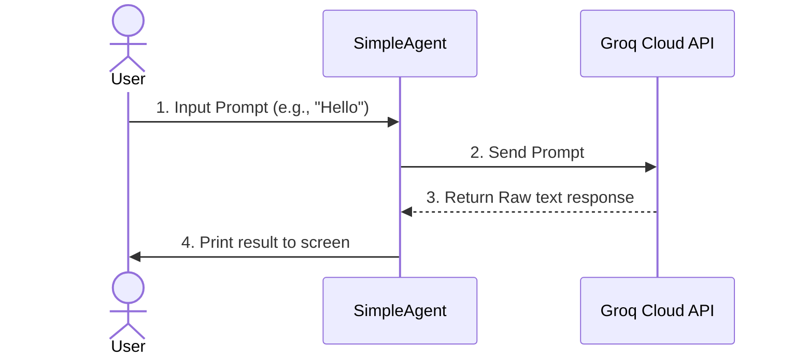
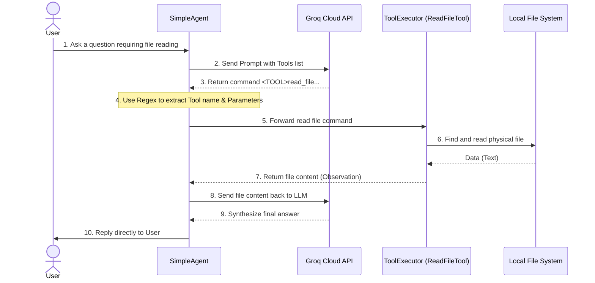
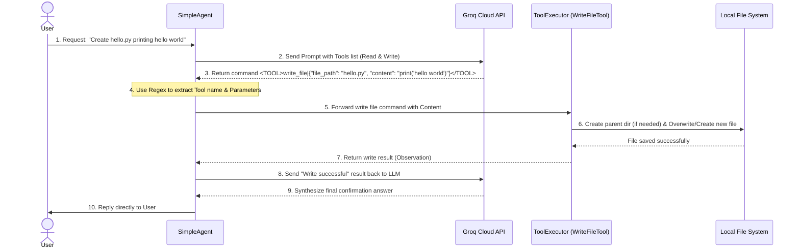
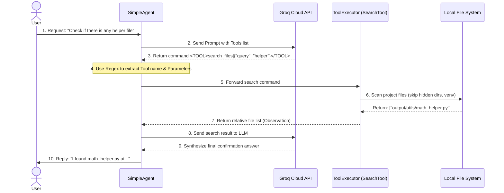
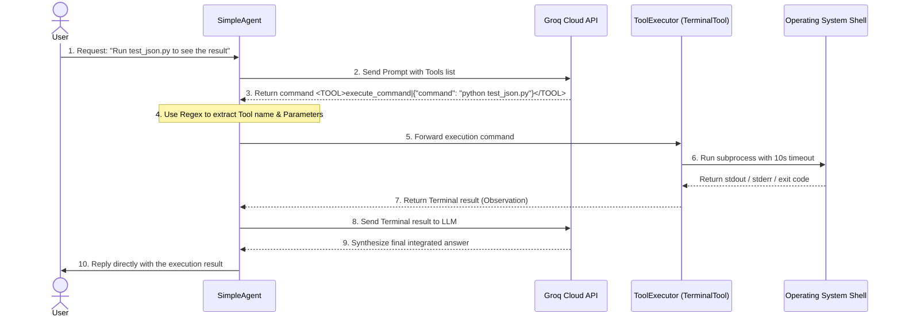
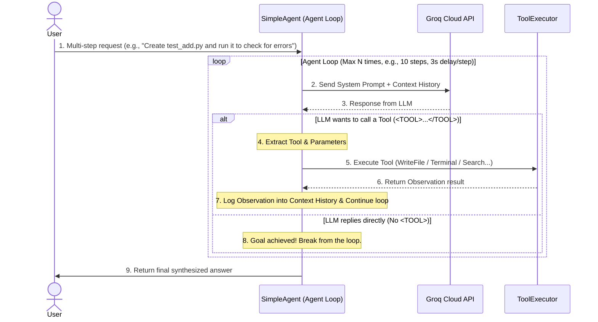
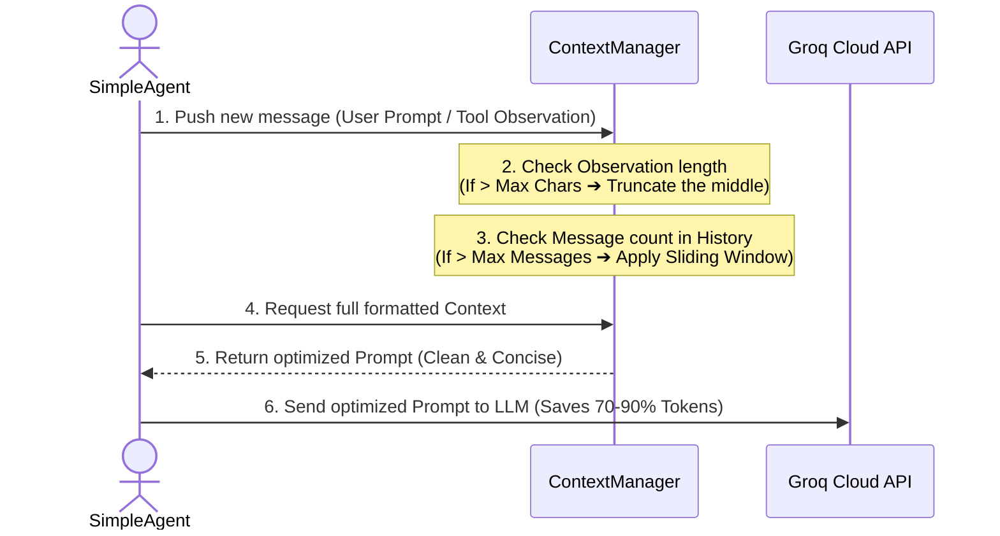

# Workflow Design

This document stores the workflow diagrams of all Milestones in the process of building the AI Agent.

---

## MILESTONE 1: Minimal AI Chat Agent (Linear Flow)

A one-way linear flow from the User to the LLM, returning results directly to the User (like a basic Chatbot).

---

## MILESTONE 2: Tool Calling - Read File (Agentic Loop)

Looping workflow: The Agent intercepts the LLM's response to execute a file reading tool on the hard drive, then feeds the result back to the LLM to synthesize the final answer.

---

## MILESTONE 3: Tool WriteFile - Write File (Creative Flow)

A workflow allowing the Agent to create new or overwrite file contents, automatically building the parent directory structure if it does not exist on the hard drive.

---

## MILESTONE 4: Tool Search - Search Files (Exploration Flow)

A workflow allowing the Agent to scan the project's directory tree to find file locations by keyword, automatically ignoring junk/hidden directories (`.git`, `.venv`, `__pycache__`).

---

## MILESTONE 5: Tool Terminal - Execute Shell Command (OS Interaction Flow)

A workflow allowing the Agent to interact directly with the operating system via Shell/CLI commands (with a 10s Timeout mechanism and safe encoding), helping the Agent auto-run code, test, and read error logs.

---

## MILESTONE 6: Agent Loop (Self-Reasoning & Self-Correction Loop)

Automated multi-step workflow (ReAct Pattern): The Agent maintains interaction history (`history_messages`), automatically calls multiple tools in succession (e.g., create file ➔ run terminal ➔ read error ➔ self-correct), and only stops when the goal is achieved or the `max_iterations` threshold is hit.

---

## MILESTONE 7: Context Management (Context Optimization & Memory Truncation)

A smart filter standing between the Agent and the LLM, trimming overly long Tool results and applying a Sliding Window to the conversation history. Ensures the Agent never exceeds the Token limit and saves API costs.

